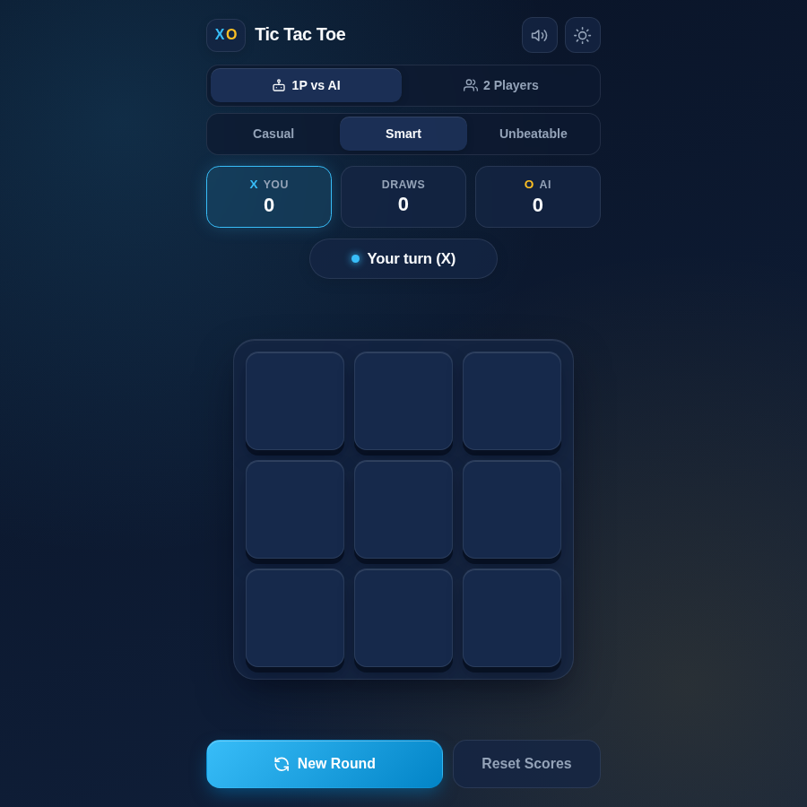

# Tic Tac Toe

A fast, modern Tic Tac Toe for phones and desktops, with a minimax AI and a
2-player mode. It's installable as an app.

**[Play it live → mike.pullen.dev/tic-tac-toe](https://mike.pullen.dev/tic-tac-toe/)**



## Features

- **Three AI difficulty levels:** Casual, Smart and Unbeatable, powered by
  minimax with alpha-beta pruning.
- **2-player mode** for playing against a friend on the same device.
- **Separate scores per mode:** 1-player and 2-player scores are tracked
  independently and saved in your browser.
- **Dark and light themes.**
- **Keyboard play:** use the arrow keys to move around the board, and Enter or
  Space to place a mark.
- **Installable PWA:** add it to your home screen or desktop.
- **Works offline:** after your first visit, you can play with no connection,
  including when it's installed as an app.
- **Sound effects** that you can mute at any time.

## Development

There's no build step. Serve the folder over HTTP (the manifest and PWA features
don't work from `file://`):

```sh
python3 -m http.server 4321
```

Then open <http://localhost:4321/>.

| Command            | What it does                                                                                       |
| ------------------ | -------------------------------------------------------------------------------------------------- |
| `npm ci`           | Install the dev tooling (once)                                                                     |
| `npm test`         | Run the unit and DOM tests (Node test runner)                                                      |
| `npm run test:e2e` | Run the Playwright browser tests (Chromium and WebKit, including offline and accessibility checks) |
| `npm run lint`     | Check formatting (Prettier) and HTML validity                                                      |
| `npm run format`   | Format the code with Prettier                                                                      |

The first `npm run test:e2e` run needs the browsers:
`npx playwright install chromium webkit`.

## Tech

Plain HTML, CSS and JavaScript, with no framework, no runtime dependencies and
no build step. It's deployed to [Vercel](https://vercel.com) as a static site,
and CI runs on GitHub Actions.

## Contributing

Work on a branch, open a pull request against `master`, and make sure CI passes.
Run `npm run format`, `npm run lint` and `npm test` before you push.
